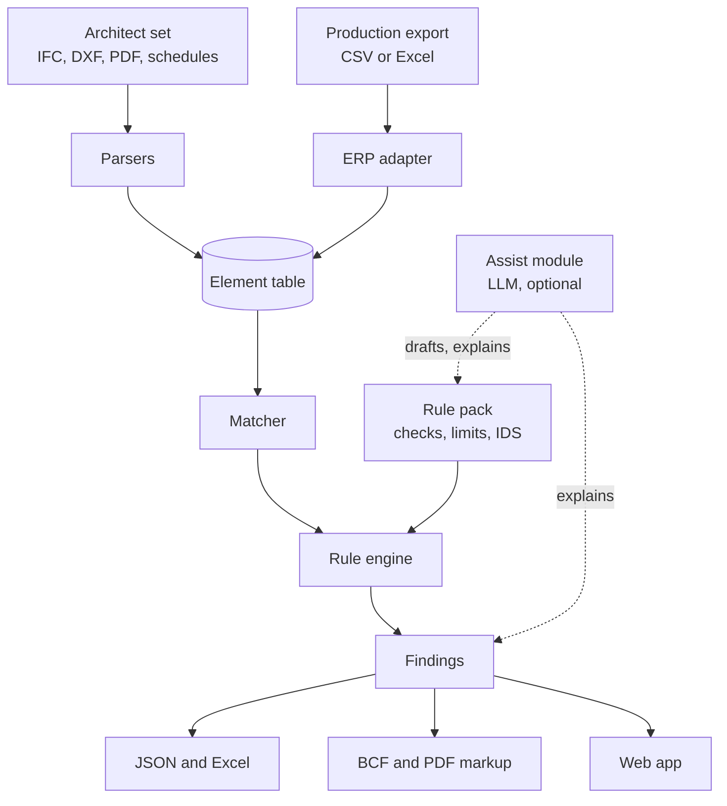

# Ludwig — architecture

## 1. Overview

Data moves in one direction. Each stage is a pure function of its inputs, which is what
makes a run reproducible.

## 2. Modules and their boundaries

| Module | Takes | Returns | May not |
|---|---|---|---|
| `parsers/*` | a file and a mapping | elements, parse warnings | apply rules, raise on bad input |
| `adapters/erp_table` | an export and a mapping | elements, parse warnings | know about any one vendor in code |
| `match` | the element table | pairs, unmatched, ambiguous | change element values |
| `rules/expr` | an expression and a context | a value or `not_checked` | call Python `eval` |
| `rules/engine` | table, pairs, pack | findings | read files, call an LLM |
| `rules/ids` | an IDS file and the table | findings | require an IFC file |
| `report/*` | findings | files | recompute anything |
| `assist` | text, findings | suggestions for a person | write findings or packs directly |
| `api` | HTTP requests | stored runs | contain check logic |

The engine depends on `model` and `rules/expr` only. Parsers depend on `model` only.
Nothing depends on `api`.

## 3. Why these choices

- **A table instead of a model graph.** Joinery checks are about attributes and
  dimensions of listed items, not about 3D shape. A flat table is enough, is easy to
  test, and lets inputs without geometry (schedules, exports) take part equally.
- **Python.** The strongest IFC library is Python-first, and the other parsers are
  mature there. Speed is not a constraint at this data size.
- **Own expression language.** It keeps packs safe to accept from customers and keeps
  every rule explainable. It stays small on purpose.
- **IDS for presence, YAML for computation.** IDS is the open standard for stating what
  data must exist; it cannot compute or compare sources, so the rest is ours.
- **Mapping files.** Every office names layers, columns and property sets differently.
  Handling that as data makes a new customer a configuration job.
- **Web app plus on-site image.** Nothing to install for most users; an option for
  factories that will not send files outside.

## 4. Dependencies and licences

| Library | Use | Licence | Note |
|---|---|---|---|
| IfcOpenShell | IFC reading | LGPL-3 | use as an unmodified library |
| ezdxf | DXF reading | MIT | |
| pdfplumber | vector PDF text and tables | MIT | replaces the earlier PyMuPDF idea (AGPL) |
| openpyxl | Excel read and write | MIT | |
| PyYAML | packs and mappings | MIT | |
| pypdf | PDF annotations | BSD | phase 4 |
| FastAPI, SQLAlchemy | service | MIT | phase 5 |

Confirm each licence at the version installed and note it in `DECISIONS.md`.
DWG is handled by an external converter process, never linked in.

## 5. Storage (phase 5)

Postgres tables: `company`, `user`, `project`, `upload`, `pack`, `run`, `finding`,
`review` (accept or dismiss with reason and user). Uploaded files go to object storage
keyed by content hash. A run stores the pack hash and the upload hashes, so it can be
repeated exactly.

## 6. What is kept from the old repository

| Old path | Kept as | Why |
|---|---|---|
| `critic/base.py` | starting point for `Finding` and statuses | the pass, fail, n/a model already exists |
| `toolkit/standards.py` | starting point for `rules/packs.py` | YAML loading with caching |
| `webapp/server.py` (`token_ok`, `origin_ok`) | reference for `api` security tests | the cross-site and token checks were correct |
| `agent/inference.py` | starting point for `assist` | provider-neutral model calls |
| `agent/budget.py` | reference for `assist` cost limits | spend projection before a run |
| `.github/workflows` | CI skeleton | matrix and kernel-presence idea |

Everything else is removed: `geometry/`, `ir/`, `backends/`, `eval/`, `store/`,
`telemetry/`, `prompts/`, `desktop/`, the Studio, the MCP server, the loop, search and
op modules, and all earlier briefs and roadmaps. They remain at the tag `harness-era-v1`.

## 7. Extension points

- A new trade: a new pack and, if needed, new element types.
- A new production system: a new mapping file; code only if the export is not tabular.
- A new input format: a new parser returning elements.
- A new output: a new reporter reading findings.

None of these should require a change to the engine. If one does, the boundary is
wrong and is fixed first.
